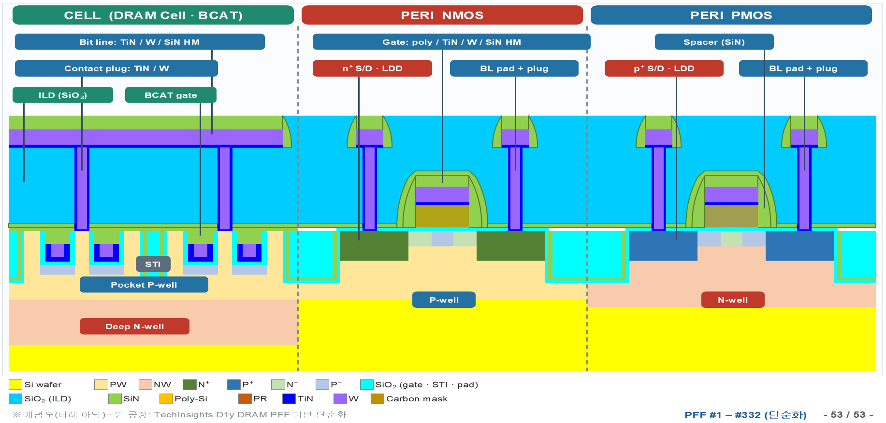
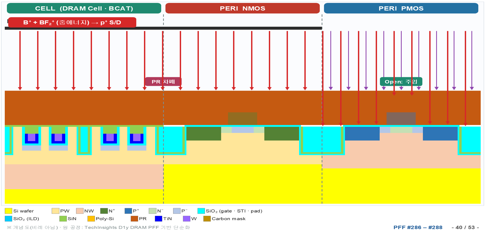
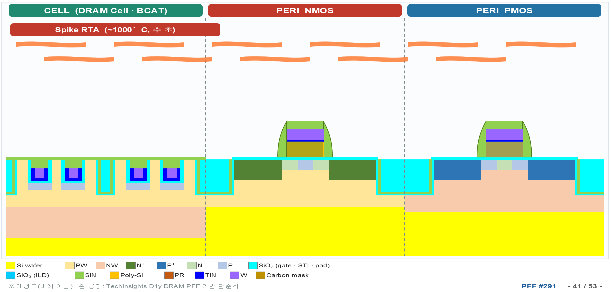

# 후속 열공정에 대한 p⁺/n 접합의 Thermal Budget 진단과 개선

| | |
|---|---|
| **사용 툴** | Synopsys Sentaurus Process T-2022.03 (Advanced Calibration 2022.03), Sentaurus Workbench |
| **개요** | DRAM 페리 PMOS의 p⁺ 접합이 견디는 후속 열의 온도·시간 범위를 공정 시뮬레이션으로 구하고, 주입 조건으로 그 범위를 넓힐 수 있는지 확인했다 |
| **상세** | [프로젝트 정리 및 수행 결과](https://mj035.github.io/TCAD_PJT/) |

모든 수치는 시뮬레이션 결과이며 실측값이 아니다.

## 상황

DRAM은 셀(트랜지스터 + 커패시터)과 페리 회로(NMOS·PMOS 트랜지스터)가 한 웨이퍼에 같이 만들어진다.

페리 PMOS의 소스·드레인은 BF₂ 주입으로 만든다.

spike RTA(약 1000 °C, 수 초)로 붕소를 활성화하면 p⁺ 접합이 완성된다.

접합이 완성된 뒤에도 CESL·ILD 증착, contact, bit line, 커패시터, 배선 공정이 같은 웨이퍼에서 이어진다. imec은 페리 트랜지스터가 이 후속 공정에서 550~600 °C를 수 시간 견뎌야 한다고 밝혔다 [1].

## 문제

| 후속 열에 의한 현상 | 지표 | 트랜지스터에 생기는 문제 |
|---|---|---|
| 붕소 확산 | 접합 깊이 Xj 증가 | 누설 전류 증가 |
| 붕소 비활성화 | 면저항 Rs 증가 | 구동 전류 감소 |

## 수행

imec이 대책으로 든 pre-amorphization implant(PAI)와 co-implant [1]를 적용해 허용 범위의 변화를 봤다.

1. n형 바탕(인 1×10¹⁸ cm⁻³)에 BF₂(10 keV, 2×10¹⁵ cm⁻²)를 주입하고 spike RTA(1050 °C)로 p⁺ 접합을 만든다. 직후의 Xj와 Rs가 기준값이다.
2. **진단**: 후속 열을 550~900 °C 8개 온도, 240분까지 가하며 Xj와 Rs가 기준값에서 +10% 벗어나는 시점을 찾는다.
3. **개선**: Ge PAI와 탄소 co-implant, spike 온도, 주입 에너지를 바꿔 같은 후속 열에서 비교한다.

총 40개 조건을 실행했다.

## 성과

기준 접합(Xj 79.7 nm, Rs 145.8 Ω/□)은 600 °C 4시간을 견디고 650 °C 4시간이 경계였다. 모든 온도에서 Xj가 Rs보다 먼저 기준을 넘었다.

| Xj 허용 시간 | 기준 | 탄소만 | PAI만 | PAI + 탄소 |
|---|---|---|---|---|
| 700 °C | 57분 | 220분 | 37분 | 240분 초과 |
| 750 °C | 18분 | 41분 | 11분 | **86분 (4.8배)** |
| 800 °C | 10분 미만 | 10분 미만 | 10분 미만 | 16분 |
| 850 °C 이상 | 10분 미만 | 10분 미만 | 10분 미만 | 10분 미만 |

- 탄소 co-implant로 4시간을 견디는 온도가 약 650 °C에서 약 700 °C로 올라갔다.
- PAI만 넣으면 기준보다 나빠진다.
- spike 온도는 Xj와 Rs의 맞교환이었고, 주입 에너지를 낮추면 허용 시간이 줄었다.

## 교훈

주입 조건으로 넓힐 수 있는 범위에는 끝이 있다. 900 °C 240분 뒤에는 네 레시피의 접합 깊이가 516~517 nm로 같아졌다.

이 한계는 imec이 장기 대안으로 든 "페리를 별도 웨이퍼에 만들어 본딩하는 방식" [1]의 필요성과 일치한다. 셀과 페리를 따로 만들어 붙이는 구조가 검토되는 배경 중 하나를 열 예산 관점에서 확인했다.

## 폴더

| 폴더 | 내용 |
|---|---|
| `code/` | Sentaurus Process 명령 파일, 후처리 스크립트 |
| `runs/` | 실행 방법, 조건별 파라미터 표와 결과 CSV |
| `results/` | 통합 CSV, 그래프 |
| `docs/` | 프로젝트 계획서, 정리 및 수행 결과 |
| `assets/` | README 그림 (DRAM 공정 흐름 개념도, 강의 자료) |

## 참고 문헌

[1] imec, "A technology platform for thermally stable DRAM peripheral transistors," 2025-05-20. https://www.imec-int.com/en/articles/technology-platform-thermally-stable-dram-peripheral-transistors
